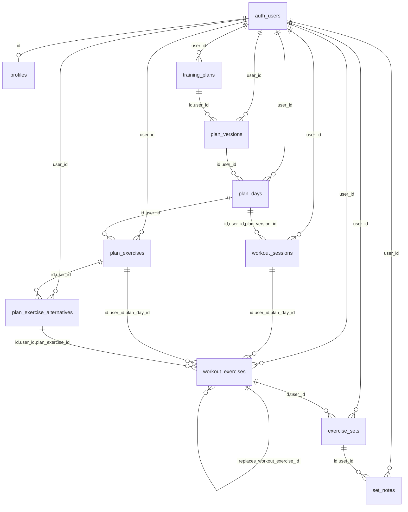

# SickFit — modello dati e contratti API

> **Fonte di riferimento per il modello dati SickFit.** Descrive lo schema `public` osservato nel progetto Supabase e i contratti applicativi verificabili nei sorgenti. Non sostituisce il catalogo PostgreSQL live. Aggiornare questo file insieme a ogni modifica dello schema, migrazione o contratto API.
>
> **Aggiornamento:** 21 novembre 2026. Le verifiche successive al primo rilievo sono indicate nelle sezioni pertinenti; lo script SQL è stato eseguito dall’utente e verificato solo tramite readback del catalogo, senza test runtime delle RPC.

## 1. Panoramica

| Proprietà | Valore verificato |
|---|---|
| Applicazione | SickFit |
| Versione frontend | `0.1.0` (`frontend/package.json`) |
| Stack frontend | Vue 3, TypeScript, Vite |
| Persistenza/autenticazione | Supabase (PostgreSQL + Supabase Auth) |
| Schema applicativo | `public` |
| Riferimento progetto Supabase | `blljepmetnvfriqjdpcn` |
| Tabelle applicative osservate | 10 |
| RLS | abilitata sulle 10 tabelle nel rilievo iniziale; il readback del 21 novembre ha verificato policy owner-scoped sulle 9 tabelle di dominio, non la policy/grants di `profiles` |
| Conteggio righe restituito dall’introspezione | 0 per ciascuna delle 10 tabelle alla data di verifica |
| Versione/ultima migrazione DB | non determinata: `sickfit-domain.sql` è stato applicato manualmente, ma non risulta registrato come migration; un elenco migrazioni vuoto non prova che non siano mai state applicate modifiche DDL |

Il tool di introspezione fornisce colonne, tipi, nullabilità, default, check, chiavi primarie, chiavi esterne e alcuni attributi di unicità/generazione. Non restituisce la definizione DDL completa, le clausole `ON DELETE`/`ON UPDATE`, l’inventario completo degli indici, le espressioni delle policy RLS, i grants o il corpo dei trigger. Questi elementi sono segnati come non determinati, non ricostruiti per supposizione.

## 2. Principi e regole del dominio

### 2.1 Regole confermate dall’introspezione DB

- Le tabelle applicative hanno chiave primaria `id` di tipo `uuid`; i default `gen_random_uuid()` sono indicati dove esposti dal catalogo.
- Le tabelle con `user_id` hanno un riferimento a `auth.users(id)`; le relazioni composite tra i record applicativi includono `user_id` per vincolare i riferimenti allo stesso proprietario.
- `profiles.username` deve essere già trim-mato e rispettare `^[A-Za-z0-9._-]{3,32}$`. `username_normalized` è generato come `lower(btrim(username))` ed è unico secondo i metadati restituiti.
- I nomi di piani, giorni ed esercizi e il testo delle note non possono essere stringhe vuote dopo `btrim`, nei punti in cui il catalogo espone il relativo check.
- Le posizioni sono positive. Le versioni di piano hanno `version_number > 0`.
- `target_sets_min >= 0`; il catalogo non ha restituito un check equivalente per `target_sets_max` né un vincolo DB `max >= min`.
- Le serie consentono ripetizioni e durata nulle; se presenti, devono essere positive. Il peso può essere nullo, altrimenti è `>= 0`. `load_basis` ammette `per_side` o `total`.
- Gli stati DB ammessi sono: sessione `in_progress` o `completed`; esercizio svolto `completed` o `skipped`.

### 2.2 Invarianti di prodotto documentati nei sorgenti

- L’isolamento dei dati deve essere garantito da RLS, non soltanto dai filtri UI. Il catalogo conferma RLS abilitata su tutte le tabelle, ma non espone qui le condizioni di ogni policy: non dedurre che le policy siano corrette senza controllare il database.
- Un piano può avere più versioni. Le sessioni storiche devono restare associate alla versione e al giorno scelti; modifiche future non devono riscrivere gli allenamenti passati.
- Il numero di serie prescritto è indicativo: gli utenti possono registrare meno o più serie o saltare esercizi.
- I carichi sono espressi in kg. `per_side` significa “per lato”; `total` significa carico totale. Non effettuare conversioni implicite.
- Una serie può avere più note testuali, conservate senza interpretazione automatica.

Le regole di prodotto di questa sezione sono requisiti documentati; non tutte sono necessariamente enforce-ate da constraint SQL. Le verifiche di implementazione e sicurezza restano distinte dalla descrizione del modello.

## 3. Tabelle e colonne

**Convenzioni:** `Nullable = No` quando l’introspezione non riporta l’opzione `nullable`; i default e i check riportati sono trascritti dal catalogo. “—” significa che il dato non è stato restituito, non che sia stato verificato assente.

### 3.1 `profiles` — profilo applicativo associato all’utente Auth

| Colonna | Tipo | Nullable | Default / generazione | Vincoli e significato |
|---|---|---:|---|---|
| `id` | `uuid` | No | — | PK; FK `auth.users(id)` |
| `username` | `text` | No | — | Trim obbligatorio; regex `^[A-Za-z0-9._-]{3,32}$` |
| `username_normalized` | `text` | Sì secondo metadati | Generata: `lower(btrim(username))` | Unica secondo metadati; usata per lookup case-insensitive |
| `created_at` | `timestamptz` | No | `now()` | Creazione |
| `updated_at` | `timestamptz` | No | `now()` | Ultimo aggiornamento; trigger `profiles_set_updated_at` verificato nel catalogo |

Readback catalogo del 21 novembre 2026: `auth.users` ha il trigger `on_auth_user_created`, che invoca `public.handle_new_auth_user()` (`SECURITY DEFINER`, `search_path` vuoto). La funzione inserisce `profiles(id, username)` usando `btrim(new.raw_user_meta_data->>'username')`. La registrazione web/mobile invia `username` come user metadata; la creazione manuale di un utente senza tale metadata può fallire o non produrre un profilo valido. Il trigger è stato letto nel catalogo, non provato con una nuova registrazione.

### 3.2 `training_plans` — schede di allenamento

| Colonna | Tipo | Nullable | Default / generazione | Vincoli e significato |
|---|---|---:|---|---|
| `id` | `uuid` | No | `gen_random_uuid()` | PK |
| `user_id` | `uuid` | No | — | FK `auth.users(id)`; proprietario |
| `name` | `text` | No | — | `btrim(name) <> ''` |
| `description` | `text` | Sì | — | Descrizione facoltativa |
| `archived_at` | `timestamptz` | Sì | — | Timestamp di archiviazione, se presente |
| `created_at` | `timestamptz` | No | `now()` | Creazione |
| `updated_at` | `timestamptz` | No | `now()` | Aggiornamento |

Chiavi esterne osservate: `user_id → auth.users(id)`. La coppia referenziata `(id, user_id)` è usata da `plan_versions`; dettagli completi di indice/constraint non esposti.

### 3.3 `plan_versions` — versioni immutabili delle schede

| Colonna | Tipo | Nullable | Default / generazione | Vincoli e significato |
|---|---|---:|---|---|
| `id` | `uuid` | No | `gen_random_uuid()` | PK |
| `user_id` | `uuid` | No | — | FK `auth.users(id)` |
| `training_plan_id` | `uuid` | No | — | FK composita `(training_plan_id,user_id) → training_plans(id,user_id)` |
| `version_number` | `integer` | No | — | `> 0` |
| `created_at` | `timestamptz` | No | `now()` | Creazione versione |

### 3.4 `plan_days` — giorni di una versione del piano

| Colonna | Tipo | Nullable | Default / generazione | Vincoli e significato |
|---|---|---:|---|---|
| `id` | `uuid` | No | `gen_random_uuid()` | PK |
| `user_id` | `uuid` | No | — | FK `auth.users(id)` |
| `plan_version_id` | `uuid` | No | — | FK composita `(plan_version_id,user_id) → plan_versions(id,user_id)` |
| `name` | `text` | No | — | `btrim(name) <> ''` |
| `position` | `integer` | No | — | `> 0`; ordine del giorno |
| `notes` | `text` | Sì | — | Note facoltative |
| `created_at` | `timestamptz` | No | `now()` | Creazione |

`workout_sessions` riferisce il giorno con `(plan_day_id,user_id,plan_version_id)`, così il giorno registrato è legato alla versione indicata.

### 3.5 `plan_exercises` — esercizi prescritti nel giorno

| Colonna | Tipo | Nullable | Default / generazione | Vincoli e significato |
|---|---|---:|---|---|
| `id` | `uuid` | No | `gen_random_uuid()` | PK |
| `user_id` | `uuid` | No | — | FK `auth.users(id)` |
| `plan_day_id` | `uuid` | No | — | FK composita `(plan_day_id,user_id) → plan_days(id,user_id)` |
| `name` | `text` | No | — | `btrim(name) <> ''` |
| `position` | `integer` | No | — | `> 0`; ordine dell’esercizio |
| `target_sets_min` | `integer` | No | `1` | `>= 0` |
| `target_sets_max` | `integer` | No | `1` | Nessun check min/max restituito dal catalogo |
| `is_optional` | `boolean` | No | `false` | Indica se l’esercizio è facoltativo |
| `prescription_notes` | `text` | Sì | — | Prescrizione facoltativa |
| `created_at` | `timestamptz` | No | `now()` | Creazione |

Relazioni osservate: alternative tramite `plan_exercise_alternatives`; sessione svolta tramite FK composita da `workout_exercises`.

### 3.6 `plan_exercise_alternatives` — alternative agli esercizi prescritti

| Colonna | Tipo | Nullable | Default / generazione | Vincoli e significato |
|---|---|---:|---|---|
| `id` | `uuid` | No | `gen_random_uuid()` | PK |
| `user_id` | `uuid` | No | — | FK `auth.users(id)` |
| `plan_exercise_id` | `uuid` | No | — | FK composita `(plan_exercise_id,user_id) → plan_exercises(id,user_id)` |
| `name` | `text` | No | — | `btrim(name) <> ''` |
| `position` | `integer` | No | — | `> 0`; ordine delle alternative |
| `created_at` | `timestamptz` | No | `now()` | Creazione |

### 3.7 `workout_sessions` — sessioni di allenamento

| Colonna | Tipo | Nullable | Default / generazione | Vincoli e significato |
|---|---|---:|---|---|
| `id` | `uuid` | No | `gen_random_uuid()` | PK |
| `user_id` | `uuid` | No | — | FK `auth.users(id)` |
| `plan_version_id` | `uuid` | No | — | Versione scelta; collegamento coerente al giorno attraverso la FK composita sottostante |
| `plan_day_id` | `uuid` | No | — | FK composita `(plan_day_id,user_id,plan_version_id) → plan_days(id,user_id,plan_version_id)` |
| `started_at` | `timestamptz` | No | `now()` | Inizio sessione |
| `completed_at` | `timestamptz` | Sì | — | Completamento |
| `status` | `text` | No | `'in_progress'` | Check: `in_progress` o `completed` |
| `notes` | `text` | Sì | — | Note facoltative |
| `created_at` | `timestamptz` | No | `now()` | Creazione |
| `updated_at` | `timestamptz` | No | `now()` | Aggiornamento |

Il catalogo non ha restituito una FK diretta separata da `plan_version_id` a `plan_versions`; la relazione del giorno comprende già `plan_version_id`. Non aggiungere o documentare un vincolo diretto senza verifica live.

### 3.8 `workout_exercises` — esercizi effettivamente svolti o saltati

| Colonna | Tipo | Nullable | Default / generazione | Vincoli e significato |
|---|---|---:|---|---|
| `id` | `uuid` | No | `gen_random_uuid()` | PK |
| `user_id` | `uuid` | No | — | FK `auth.users(id)` |
| `workout_session_id` | `uuid` | No | — | FK composita `(workout_session_id,user_id,plan_day_id) → workout_sessions(id,user_id,plan_day_id)` |
| `plan_day_id` | `uuid` | No | — | FK composita con la sessione e con l’esercizio pianificato |
| `plan_exercise_id` | `uuid` | Sì | — | FK composita `(plan_exercise_id,user_id,plan_day_id) → plan_exercises(id,user_id,plan_day_id)` |
| `selected_alternative_id` | `uuid` | Sì | — | FK composita `(selected_alternative_id,user_id,plan_exercise_id) → plan_exercise_alternatives(id,user_id,plan_exercise_id)` |
| `actual_name` | `text` | No | — | `btrim(actual_name) <> ''`; nome effettivamente svolto |
| `status` | `text` | No | `'completed'` | Check: `completed` o `skipped` |
| `replaces_workout_exercise_id` | `uuid` | Sì | — | FK ricorsiva composita sullo stesso utente e sessione |
| `position` | `integer` | No | — | `> 0`; ordine nella sessione |
| `notes` | `text` | Sì | — | Note facoltative |
| `created_at` | `timestamptz` | No | `now()` | Creazione |

### 3.9 `exercise_sets` — serie registrate per un esercizio svolto

| Colonna | Tipo | Nullable | Default / generazione | Vincoli e significato |
|---|---|---:|---|---|
| `id` | `uuid` | No | `gen_random_uuid()` | PK |
| `user_id` | `uuid` | No | — | FK `auth.users(id)` |
| `workout_exercise_id` | `uuid` | No | — | FK composita `(workout_exercise_id,user_id) → workout_exercises(id,user_id)` |
| `position` | `integer` | No | — | `> 0`; ordine della serie |
| `reps` | `integer` | Sì | — | Nullo o `> 0` |
| `weight_kg` | `numeric` | Sì | — | Nullo o `>= 0` |
| `load_basis` | `text` | No | `'per_side'` | Check: `per_side` o `total` |
| `duration_seconds` | `integer` | Sì | — | Nullo o `> 0` |
| `created_at` | `timestamptz` | No | `now()` | Creazione |

### 3.10 `set_notes` — note testuali associate a una serie

| Colonna | Tipo | Nullable | Default / generazione | Vincoli e significato |
|---|---|---:|---|---|
| `id` | `uuid` | No | `gen_random_uuid()` | PK |
| `user_id` | `uuid` | No | — | FK `auth.users(id)` |
| `exercise_set_id` | `uuid` | No | — | FK composita `(exercise_set_id,user_id) → exercise_sets(id,user_id)` |
| `text` | `text` | No | — | `btrim(text) <> ''`; contenuto originale |
| `position` | `integer` | No | — | `> 0`; ordine della nota |
| `created_at` | `timestamptz` | No | `now()` | Creazione |

## 4. Relazioni

`auth_users` rappresenta `auth.users`, gestita da Supabase e fuori dallo schema applicativo `public`. La cardinalità visualizzata è una guida alle FK osservate; non documenta regole di cancellazione, obbligatorietà applicativa o cardinalità garantite da vincoli non restituiti dal catalogo.

## 5. Indici, vincoli e integrità

### Indici osservati

- Chiave primaria su `id` per ciascuna delle 10 tabelle (l’indice fisico associato non è descritto separatamente dal tool).
- `profiles.username_normalized` risulta unico nei metadati restituiti.
- L’elenco completo degli indici secondari, dei nomi degli indici e delle colonne incluse non è stato restituito. Non assumere che esistano o manchino indici ulteriori; ricavare l’inventario dal catalogo live prima di modifiche di performance.

### FK e vincoli

Le FK riportate nelle tabelle sopra sono trascritte dai metadati Supabase, incluse le FK composite che portano `user_id` e gli identificatori di parent. Il catalogo interrogato non ha esposto comportamento `ON DELETE`/`ON UPDATE`, deferrability o tutte le constraint expressions. Consultare la definizione live prima di migrazioni o query distruttive.

### RLS e privilegi

RLS risulta abilitata sulle tabelle osservate. Il readback del 21 novembre 2026 ha verificato una policy owner-scoped `ALL` sulle nove tabelle di dominio e i privilegi effettivi necessari alle RPC; non ha verificato l’isolamento con richieste fra account distinti né la policy/grants di `profiles`. Non dedurre sicurezza runtime dalla sola presenza delle policy.

## 6. Regole di validazione dati

| Area | Regola DB osservata | Ulteriori regole applicative/documentate |
|---|---|---|
| Username | trim e regex 3–32 caratteri alfanumerici, punto, underscore o trattino; normalizzazione `lower(btrim(...))` | Lookup non sensibile a maiuscole/minuscole; email Auth deve corrispondere nel flusso login |
| Nomi scheda/giorno/esercizio/alternativa | non vuoti dopo `btrim` dove presente il check | limiti massimi e messaggi UI non sono definiti dal catalogo |
| Versione | `version_number > 0` | le modifiche future devono creare una nuova versione preservando lo storico |
| Posizioni | `position > 0` | ordinano gli elementi; non rappresentano un limite di quantità |
| Serie prescritte | `target_sets_min >= 0`; `target_sets_max` senza check esposto | Target indicativo; le serie effettive possono essere inferiori o superiori |
| Serie registrate | reps/durata null o positive; peso null o non negativo; modalità `per_side`/`total` | kg; niente conversione automatica; note multiple conservate separatamente |
| Stato sessione | `in_progress`, `completed` | il client aggiorna lo stato a `completed` al completamento |
| Stato esercizio | `completed`, `skipped` | un esercizio saltato non richiede serie |

L’import JSON è documentato come implementato nel frontend e va ricontrollato nella versione target; import Notion non implementato.

## 7. Accesso dati e query pattern

Il frontend in `frontend/` usa `@supabase/supabase-js` con `VITE_SUPABASE_URL` e `VITE_SUPABASE_PUBLISHABLE_KEY`; il mobile usa `EXPO_PUBLIC_SUPABASE_URL` e `EXPO_PUBLIC_SUPABASE_PUBLISHABLE_KEY`. La chiave `service_role` non deve mai essere usata nei client. Il codice locale attuale instrada le operazioni di dominio via Edge Function `domain`; Auth è diretto, con lettura del solo `profiles.username_normalized` del profilo autenticato. Questa lettura dipende da una policy SELECT RLS che non è stata ricontrollata live.

Pattern nel contratto locale `domain` (sorgente non distribuito):

1. `plans.list`: legge schede non archiviate, versioni, giorni, esercizi e alternative sotto il JWT/RLS del chiamante; restituisce la versione più recente.
2. `plans.save`: usa RPC transazionale per creare piano/versione o nuova versione senza riscrivere lo storico.
3. `workouts.start`, `workouts.complete` e `workouts.cancel`: RPC transazionali; completamento scrive esercizi, serie, durata e note e poi chiude la sessione.
4. `history.list` e `history.detail`: letture sotto il JWT/RLS; include le sessioni aperte oltre alle 50 più recenti.
5. I filtri applicativi per `user_id` non sostituiscono RLS. Policy, grants e comportamento effettivo non sono stati verificati live per questa implementazione.

Il pattern diretto usato dalla versione precedente della PWA è storico e non descrive più il flusso di dominio corrente nel tree. L’API/RPC attuale resta da verificare e distribuire.

Non sono documentati piani di query, volumi attesi, benchmark o soglie di latenza. Non inventare target di performance; aggiungerli solo dopo una decisione di prodotto e misurazioni concordate.

## 8. Contratti API e autenticazione

### Client → Supabase Auth

- Registrazione web: `auth.signUp` con email normalizzata in minuscolo, password e `username` in `user_metadata`; il trigger live `on_auth_user_created` usa tale campo per creare il profilo. Il client può ricevere sessione oppure richiesta di conferma email. Il sorgente web non passa `emailRedirectTo`, quindi il redirect di conferma dipende dal `Site URL` configurato in Supabase Auth.
- Stato sessione: persistenza, auto-refresh e rilevazione callback URL sono abilitate nella configurazione client.
- Registrazione e login nel web/mobile restano Supabase Auth diretto. Il login a tre campi effettua `signInWithPassword`, poi legge `profiles.username_normalized` per il solo utente autenticato sotto RLS; questo richiede policy SELECT compatibile e non è stato verificato live.
- Recupero password mobile usa redirect `sickfit://auth/callback`; configurazione e callback sono solo codice locale e richiedono allowlist Auth e test su dispositivo.

### Edge Function `login-with-username` — sola implementazione locale

- Invocazione dal client: `functions.invoke('login-with-username', { body })`.
- Metodo supportato dal sorgente: `POST`; `OPTIONS` per preflight. `verify_jwt = false` in `backend/supabase/config.toml` perché l’accesso avviene prima della sessione.
- Request JSON: `{ "username": string, "email": string, "password": string }`.
- Il sorgente normalizza username/email, cerca il profilo per `username_normalized`, confronta l’email di `auth.users`, quindi delega la verifica password a `auth.signInWithPassword`.
- Successo nel sorgente: HTTP 200 con `{ "session": { "access_token": string, "refresh_token": string } }`; i token sono consegnati al client solo per `auth.setSession`.
- Errori definiti nel sorgente: 401 per credenziali/input non validi o eccezioni; 403 per origine CORS non consentita; 405 per metodo non consentito; 500 se la funzione non è configurata. La risposta credenziali non valide è generica.
- CORS nel sorgente: `http://localhost:5173` e origini da `SICKFIT_ALLOWED_ORIGINS`. Le risposte impostano `Cache-Control: no-store`.
- Segreti richiesti server-side dal sorgente: `SUPABASE_URL`, `SUPABASE_PUBLISHABLE_KEY` (oppure `SUPABASE_ANON_KEY`) e `SUPABASE_SERVICE_ROLE_KEY`. Non riportare valori in questo file.

**Stato di distribuzione:** la funzione è solo sorgente locale e non risulta deployata/provata secondo README e AGENTS.md. Il contratto sopra descrive il sorgente, non un endpoint pubblicamente disponibile. Rate limiting e verifica della configurazione CORS restano prerequisiti di sicurezza prima di un deploy.

### Edge Function `domain` — implementazione locale, contratto v1

- Sorgente locale: `backend/supabase/functions/domain/index.ts`; configurazione `verify_jwt = true` in `backend/supabase/config.toml`.
- Azioni: `plans.list`, `plans.save`, `plans.archive`, `workouts.start`, `workouts.complete`, `workouts.cancel`, `history.list`, `history.detail`. Contratto e payload sono in [`api-contract.md`](api-contract.md) e nel [README della funzione](../backend/supabase/functions/domain/README.md).
- La funzione richiede un JWT Supabase valido, chiama `auth.getUser(token)`, crea un client per richiesta con publishable key e bearer JWT e passa alle query/RPC il contesto utente, dipendendo da RLS e grants; non usa `service_role` e non accetta `user_id` dal payload.
- Le scritture chiamano cinque RPC `SECURITY INVOKER` descritte in [`sickfit-domain.sql`](sickfit-domain.sql). L’utente ha eseguito lo script nel progetto SickFit il 21 novembre 2026. Readback catalogo successivo: tutte e cinque le funzioni presenti con `search_path` vuoto e permesso EXECUTE ad `authenticated`; RLS attiva sulle nove tabelle di dominio, una policy owner-scoped `ALL` per tabella, e privilegi effettivi `authenticated` per i permessi richiesti dalle RPC.
- Lo stesso readback ha confermato le colonne richieste (incl. `exercise_sets.duration_seconds`), constraint/FK rilevanti e trigger `updated_at` su `training_plans` e `workout_sessions`. Non sono state invocate le RPC, testate transazioni/isolamento con utenti reali né distribuita l’Edge Function.
- **Stato:** sorgente Edge locale non distribuito e non testato. CORS, rate limiting/quote, comportamento runtime, Auth/profile RLS, e client mobile richiedono verifica prima di qualsiasi deploy.

## 9. Migrazioni e storia dello schema

- `mcp__supabase__list_migrations` aveva restituito un elenco vuoto nella verifica precedente; il successivo readback catalogo ha verificato le funzioni, ma non la registrazione della query manuale come migrazione.
- `sickfit-domain.sql` è stato eseguito manualmente dall’utente il 21 novembre 2026; non è una migration Supabase locale/registrata. `backend/supabase/config.toml` configura localmente `login-with-username` e `domain`; la configurazione locale non attesta il deploy della Edge Function.
- Non sono quindi determinati numero di versione DB, date/autori delle migrazioni o motivazioni delle modifiche DDL. Non interpretare un elenco vuoto come prova che lo schema non sia mai stato modificato.
- Quando saranno introdotte migrazioni autorizzate, registrare in questa sezione ID, data, motivazione e oggetti toccati, senza sostituire i sorgenti di migrazione.

## 10. Sicurezza e limiti di verifica

- Dati utente: readback catalogo del 21 novembre 2026 ha verificato RLS abilitata e policy owner-scoped `ALL` sulle nove tabelle di dominio, oltre ai privilegi tabellari effettivi necessari alle RPC. L’isolamento effettivo fra account non è stato provato con richieste runtime.
- Credenziali: solo publishable key nel client; l’Edge Function `domain` non usa `service_role`, che non deve essere inserita nel frontend.
- Non esporre token, password, chiavi o dati personali nella documentazione.
- Nessuna query su righe applicative o dati personali è stata eseguita per produrre questo documento; le verifiche successive al run hanno letto solo cataloghi e metadati.
- Questa documentazione non è un audit di sicurezza e non certifica correttezza, completezza o conformità delle policy.

## 11. Aggiornamento e fonti

Aggiornare questo documento nella stessa modifica approvata che cambia tabelle, colonne, default, constraint, relazioni, RLS/grants, indici, funzioni o contratti API. Prima di ogni aggiornamento confrontare sorgenti/migrazioni e catalogo live in sola lettura. Tenere separate le informazioni DB confermate, le regole di prodotto e le lacune da verificare.

Fonti controllate per questa revisione:

- Catalogo Supabase tramite query read-only su colonne, constraint/FK, policy, privilegi effettivi, funzioni, RLS e trigger, progetto SickFit, 21 novembre 2026.
- Elenco migrazioni Supabase tramite tool read-only `list_migrations`.
- Sorgenti locali (stato da ricontrollare attentamente): `frontend/package.json`, `frontend/src/lib/supabase.ts`, `frontend/src/lib/auth.ts`, `frontend/src/lib/domain.ts`, `frontend/src/App.vue`, `backend/supabase/config.toml`, `backend/supabase/functions/login-with-username/index.ts`, `backend/supabase/functions/domain/index.ts`, `docs/sickfit-domain.sql`, `mobile/`, README e AGENTS.

Dati ancora da verificare — comportamento runtime delle RPC, isolamento con account distinti, CORS/limiti, Auth/profile policies, definizione completa degli indici e registrazione della query manuale nella storia delle migrazioni — restano aperti prima di dichiarare il rilascio pronto.
